[English](README.md) · [Русский](README.ru.md) · **Deutsch**

# Easy Hyprland

Eine einfache, schöne grafische Oberfläche zum Konfigurieren von [Hyprland](https://hyprland.org).
Du musst die Konfig-Syntax nicht lernen: Regler verschieben, Farben wählen und **Speichern und anwenden** drücken.

Geschrieben in **Rust** mit [egui](https://github.com/emilk/egui). Die Oberfläche gibt es auf Deutsch, Englisch und Russisch.

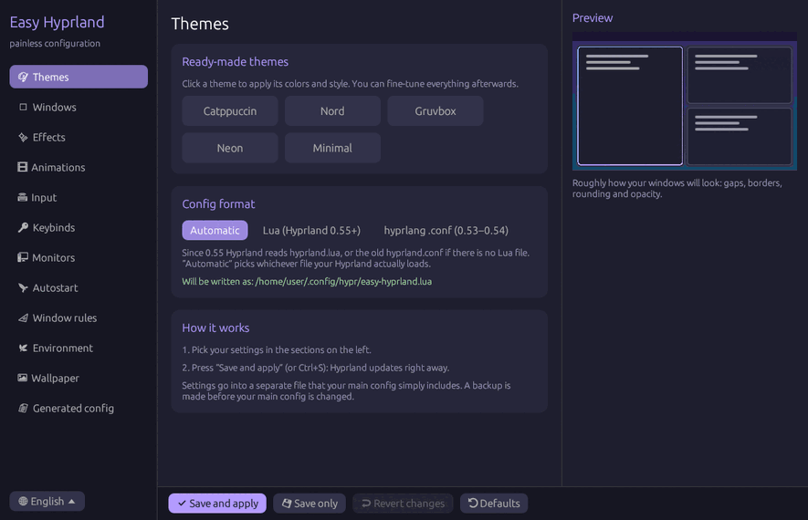

## Funktionen

- 🎨 **Themes**: Catppuccin, Nord, Gruvbox, Neon und Minimal, jeweils mit einem Klick
- 🪟 **Fenster**: Abstände, Rahmen, Verlaufsrahmen, Eckenrundung, Layout (dwindle, master, scrolling, monocle)
- ✨ **Effekte**: Transparenz, Unschärfe (Blur), Schatten, Abdunkeln inaktiver Fenster
- 🎞 **Animationen**: an/aus, Geschwindigkeit, Stil (weich, zackig, federnd)
- ⌨ **Eingabe**: Tastaturlayouts und Layoutwechsel, Mausempfindlichkeit, Touchpad, Drei-Finger-Wischen zwischen Arbeitsflächen
- 🔑 **Tastenkürzel**: Standardprogramme und ein Kürzel-Editor
- 🖥 **Monitore**: Auflösung, Bildwiederholrate, Position, Skalierung
- 🚀 **Autostart** von Programmen
- 📐 **Fensterregeln**
- 🌿 **Umgebungsvariablen**
- 🖼 **Hintergrund** mit hyprpaper
- 📄 **Fertige Konfig**: ansehen, kopieren, eigene Zeilen hinzufügen
- 👀 **Live-Vorschau** deiner Fenster direkt in der App
- 🛟 **Sicher**: vor Änderungen an deiner Konfig wird eine Sicherung angelegt, und nach dem Anwenden werden Konfigfehler von Hyprland angezeigt

## Screenshots

Die fünf eingebauten Themes in der Live-Vorschau:

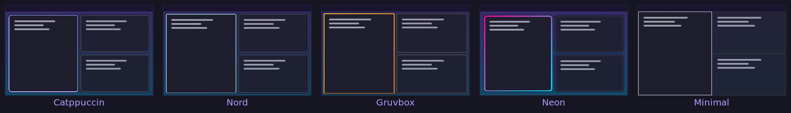

Alle Bereiche der App:

<table>
  <tr>
    <td width="50%" align="center">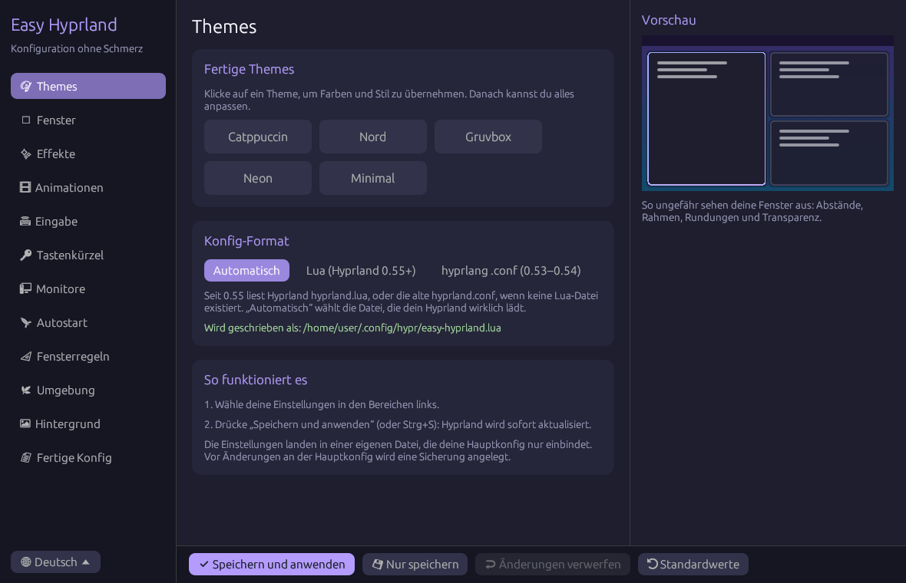<br><sub>Themes und Konfig-Format</sub></td>
    <td width="50%" align="center">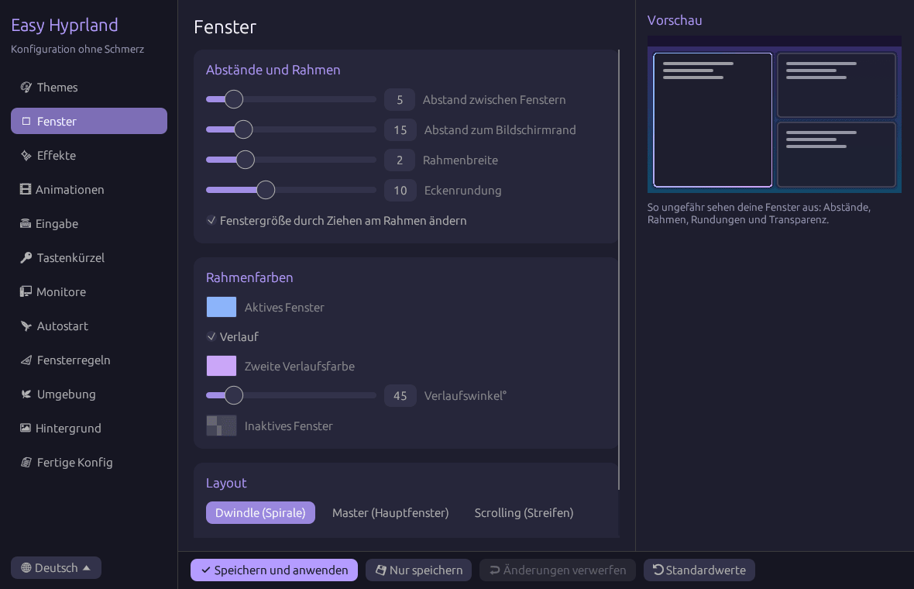<br><sub>Fenster: Abstände, Rahmen, Layout</sub></td>
  </tr>
  <tr>
    <td width="50%" align="center">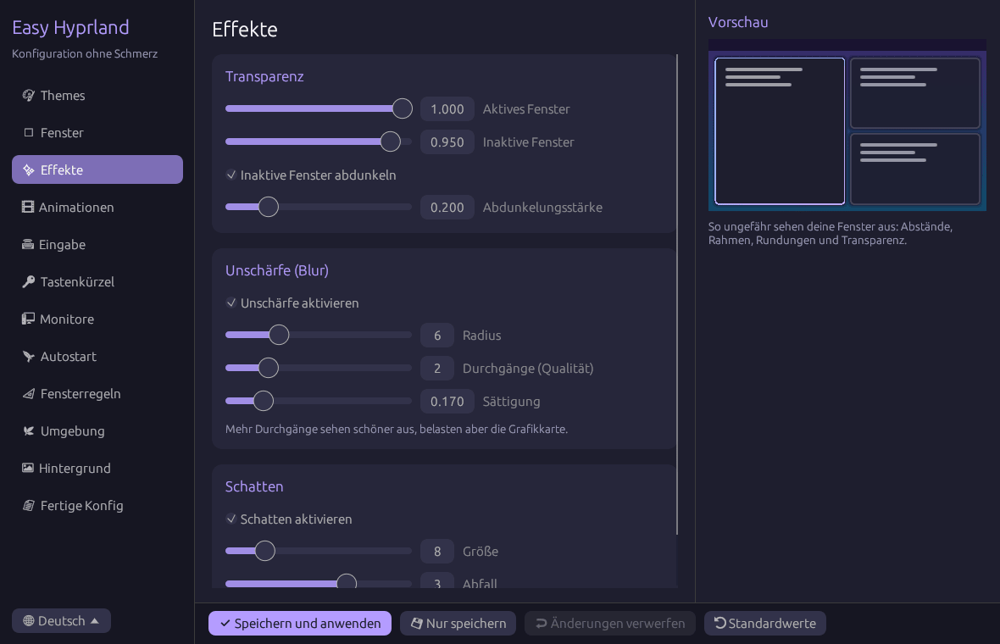<br><sub>Effekte: Transparenz, Blur, Schatten</sub></td>
    <td width="50%" align="center">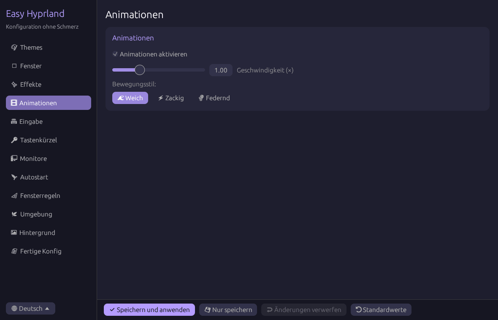<br><sub>Animationen</sub></td>
  </tr>
  <tr>
    <td width="50%" align="center">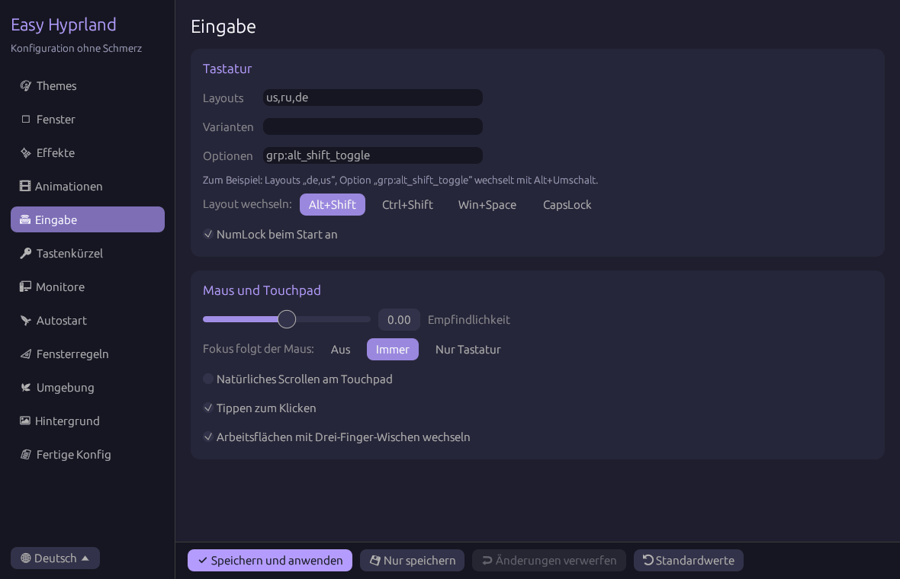<br><sub>Eingabe: Tastatur, Maus, Touchpad</sub></td>
    <td width="50%" align="center">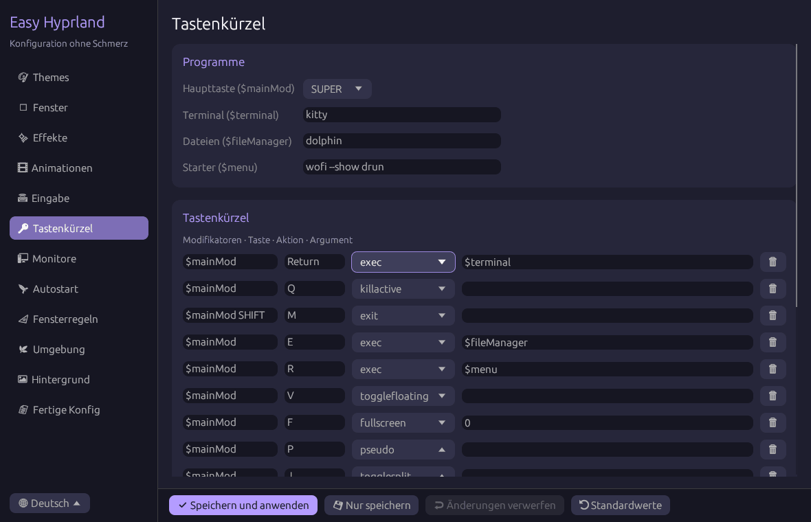<br><sub>Tastenkürzel</sub></td>
  </tr>
  <tr>
    <td width="50%" align="center">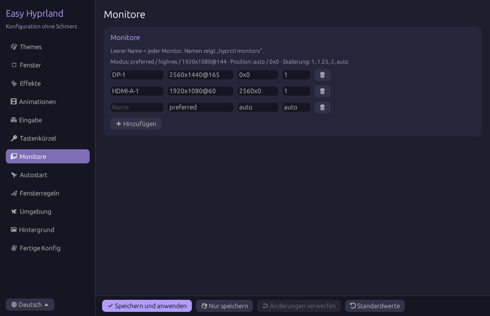<br><sub>Monitore</sub></td>
    <td width="50%" align="center">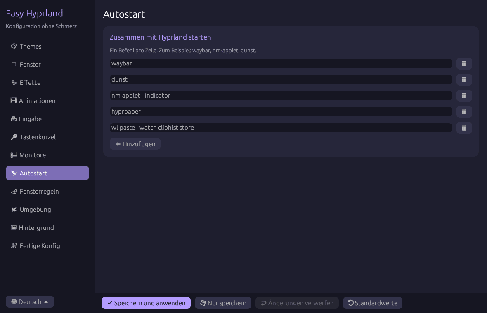<br><sub>Autostart</sub></td>
  </tr>
  <tr>
    <td width="50%" align="center">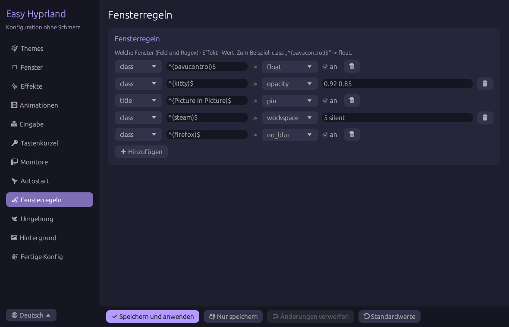<br><sub>Fensterregeln</sub></td>
    <td width="50%" align="center">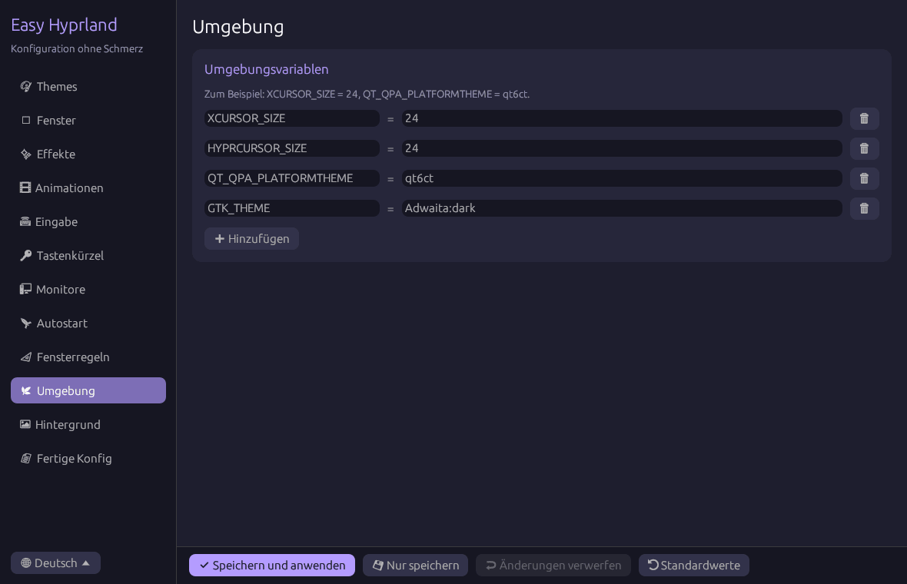<br><sub>Umgebungsvariablen</sub></td>
  </tr>
  <tr>
    <td width="50%" align="center">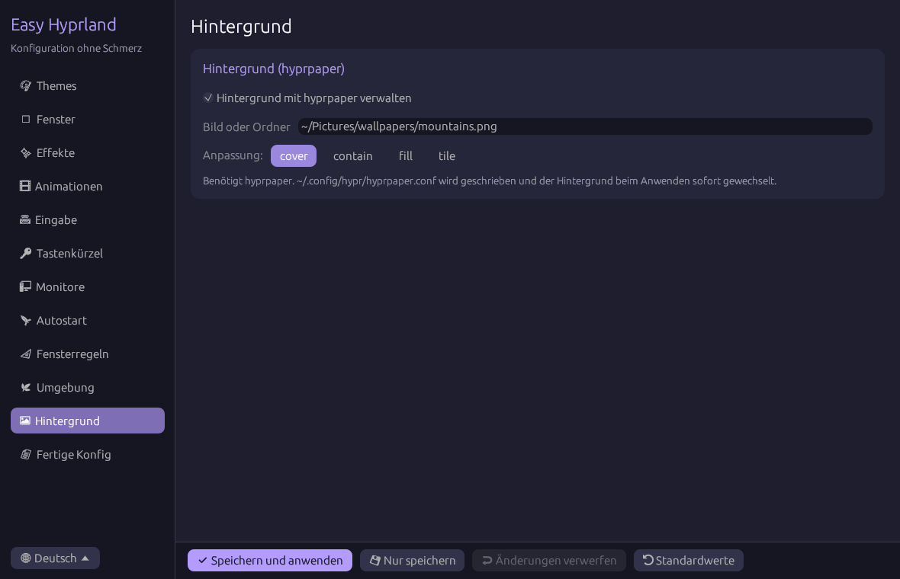<br><sub>Hintergrund (hyprpaper)</sub></td>
    <td width="50%" align="center">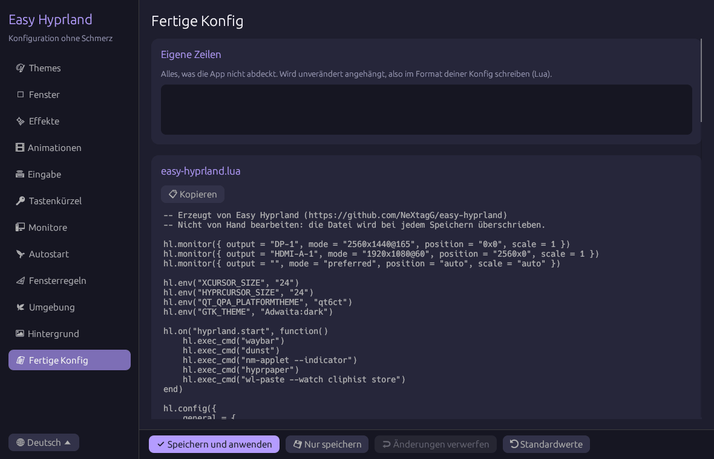<br><sub>Fertige Konfig</sub></td>
  </tr>
</table>

## Unterstützte Hyprland-Versionen

| Hyprland | Konfig-Format | Unterstützung |
|---|---|---|
| **0.55 und neuer** | Lua (`hyprland.lua`) | ✅ |
| **0.53 – 0.54** | hyprlang (`hyprland.conf`) | ✅ |
| älter als 0.53 | alte hyprlang-Syntax | ❌ |

Das Format wird automatisch erkannt. Seit 0.55 lädt Hyprland `hyprland.lua` und liest die alte `hyprland.conf` nur, wenn keine Lua-Datei existiert. Die App schreibt deshalb in die Datei, die dein Hyprland tatsächlich lädt. Auf der Seite **Themes** kannst du das Format auch selbst wählen.

## Installation

### Arch Linux

Ein `PKGBUILD` liegt bei. Es baut die neueste Version aus git:

```bash
git clone https://github.com/NeXtagG/easy-hyprland.git
cd easy-hyprland/packaging/arch
makepkg -si
```

Danach erscheint die App in deinem Starter als **Easy Hyprland**.

### NixOS

Ohne Installation ausprobieren:

```bash
nix run github:NeXtagG/easy-hyprland
```

Mit Flakes installieren (in der `flake.nix` deines Systems):

```nix
{
  inputs.easy-hyprland.url = "github:NeXtagG/easy-hyprland";

  outputs = { nixpkgs, easy-hyprland, ... }: {
    nixosConfigurations.myhost = nixpkgs.lib.nixosSystem {
      modules = [
        ({ pkgs, ... }: {
          environment.systemPackages = [
            easy-hyprland.packages.${pkgs.stdenv.hostPlatform.system}.default
          ];
        })
      ];
    };
  };
}
```

Ohne Flakes:

```bash
nix-env -f https://github.com/NeXtagG/easy-hyprland/archive/main.tar.gz -i
```

#### Wenn deine Hyprland-Konfig von home-manager verwaltet wird

Mit home-manager ist `hyprland.lua` bzw. `hyprland.conf` ein schreibgeschützter Link in den `/nix/store`. Easy Hyprland fasst ihn nie an: die App schreibt ihre eigene Datei und zeigt die eine Zeile, die du selbst hinzufügen musst. Füge sie einmal hinzu und baue neu:

Lua-Konfig (Hyprland 0.55+), wenn die Datei über home-manager kommt:

```nix
xdg.configFile."hypr/hyprland.lua".text = ''
  -- deine Konfig
  require("easy-hyprland")
'';
```

hyprlang-Konfig (Hyprland 0.53–0.54):

```nix
wayland.windowManager.hyprland.extraConfig = ''
  source = ~/.config/hypr/easy-hyprland.conf
'';
```

Danach änderst du alles wie gewohnt in der App: **Speichern und anwenden** schreibt nur `easy-hyprland.lua` bzw. `easy-hyprland.conf` neu.

### Andere Distributionen

Installiere Rust (zum Beispiel mit [rustup](https://rustup.rs)), dann:

```bash
git clone https://github.com/NeXtagG/easy-hyprland.git
cd easy-hyprland
cargo install --locked --path .
```

Das Programm landet in `~/.cargo/bin/easy-hyprland`. Achte darauf, dass `~/.cargo/bin` in deinem `PATH` ist. Für den App-Starter kopiere `packaging/easy-hyprland.desktop` nach `~/.local/share/applications/`.

## Benutzung

1. Starte `easy-hyprland` im Terminal oder über deinen Starter (wofi, rofi, hyprlauncher…).
2. Wähle links einen Bereich, zum Beispiel **Themes** oder **Fenster**.
3. Ändere die Einstellungen. Die Vorschau rechts wird sofort aktualisiert.
4. Drücke **Speichern und anwenden** (oder **Strg+S**). Hyprland lädt sofort neu, ohne Neuanmeldung.

Die Sprache wird aus der Systemsprache übernommen. Du kannst sie unten in der Seitenleiste ändern.

| Schaltfläche | Was sie tut |
|---|---|
| ✔ Speichern und anwenden | schreibt die Konfig, führt `hyprctl reload` aus und zeigt eventuelle Konfigfehler |
| 💾 Nur speichern | schreibt nur die Dateien |
| ↩ Änderungen verwerfen | kehrt zu den zuletzt gespeicherten Einstellungen zurück |
| ⟲ Standardwerte | setzt alles auf die Standardwerte zurück |

Wenn du das Fenster mit ungespeicherten Änderungen schließt, fragt die App, ob sie gespeichert werden sollen.

## So funktioniert es

- Deine Einstellungen werden in eine eigene Datei geschrieben:
  - Lua: `~/.config/hypr/easy-hyprland.lua`
  - hyprlang: `~/.config/hypr/easy-hyprland.conf`
- Ans Ende deiner Hauptkonfig (`hyprland.lua` oder `hyprland.conf`) wird eine Zeile angehängt:
  ```lua
  require("easy-hyprland")                         -- Lua
  ```
  ```ini
  source = /home/du/.config/hypr/easy-hyprland.conf   # hyprlang
  ```
  Vorher wird eine Kopie `hyprland.lua.bak-<Zeit>` (oder `hyprland.conf.bak-<Zeit>`) angelegt. Deine bisherige Konfig bleibt erhalten, die Einstellungen der App werden darüber angewendet.
- Gibt es noch keine Hauptkonfig, wird sie erstellt.
- Der Zustand der App liegt in `~/.config/easy-hyprland/settings.json`.
- Mit aktiviertem Hintergrund wird `~/.config/hypr/hyprpaper.conf` geschrieben. Eine fremde hyprpaper-Konfig wird vorher gesichert.
- `$XDG_CONFIG_HOME` wird berücksichtigt.

### Deinstallieren

Entferne die Zeile `require("easy-hyprland")` bzw. `source = …easy-hyprland.conf` aus deiner Hauptkonfig und führe aus:

```bash
cargo uninstall easy-hyprland
rm -r ~/.config/easy-hyprland ~/.config/hypr/easy-hyprland.*
```

## Entwicklung

```bash
cargo run              # App starten
cargo test             # Unit-Tests
tests/validate.sh      # erzeugte Konfigs gegen Hyprland 0.56.2 prüfen (benötigt lua5.4 und python3)
```

`tests/validate.sh` erzeugt Beispielkonfigs in beiden Formaten und prüft jede Option, jeden Dispatcher und jeden Fensterregel-Effekt gegen Listen aus dem Quellcode von Hyprland 0.56.2 (`tests/hyprland-0.56.2/`). Die Lua-Konfigs werden gegen einen strikten Mock der `hl`-API ausgeführt.

Pull Requests sind willkommen!

## Lizenz

Dieses Projekt steht unter der **GNU GPL v3.0 oder neuer**. Der vollständige Text steht in [LICENSE](LICENSE).

Einfach gesagt:
- ✅ jeder darf das Programm **kostenlos nutzen**, auch beruflich;
- ✅ du darfst den Code **ändern** und **weitergeben**;
- ❗ wenn du eine geänderte Version weitergibst, muss ihr Quellcode ebenfalls unter der GPL-3.0 **offen** sein.
