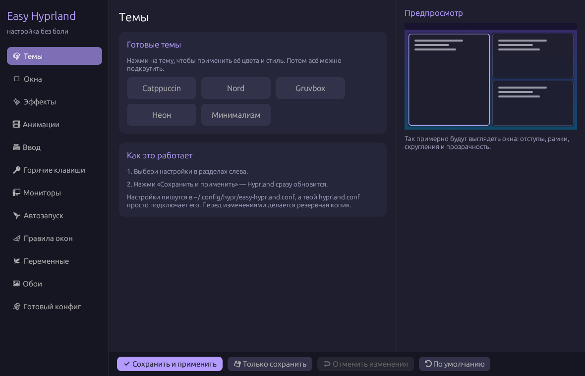

# Easy Hyprland

Программа для простой настройки [Hyprland](https://hyprland.org) с понятным графическим интерфейсом.
Вам не нужно разбираться в синтаксисе конфигов: двигайте ползунки, выбирайте цвета и нажмите «Сохранить и применить».

Написано на **Rust** с [egui](https://github.com/emilk/egui).



## Возможности

- 🎨 **Темы**: Catppuccin, Nord, Gruvbox, Неон, Минимализм в один клик
- 🪟 **Окна**: отступы, рамки, градиент рамки, скругление, раскладка dwindle/master
- ✨ **Эффекты**: прозрачность, размытие (blur), тени, затемнение неактивных окон
- 🎞 **Анимации**: включение, скорость, стиль (плавный, быстрый, пружинистый)
- ⌨ **Ввод**: раскладки и их переключение, чувствительность мыши, тачпад
- 🔑 **Горячие клавиши**: программы по умолчанию и редактор сочетаний клавиш
- 🖥 **Мониторы**: разрешение, частота, позиция, масштаб
- 🚀 **Автозапуск**: `exec-once`
- 📐 **Правила окон**: `windowrulev2`
- 🌿 **Переменные окружения**: `env`
- 🖼 **Обои** через hyprpaper
- 📄 **Готовый конфиг**: просмотр, копирование и свои строки
- 👀 **Живой предпросмотр** окон прямо в программе
- 🛟 **Безопасно**: перед изменением файлов делается резервная копия

## Установка

### 1. Установите Rust

```bash
# Arch Linux
sudo pacman -S rust
# или любой дистрибутив
curl --proto '=https' --tlsv1.2 -sSf https://sh.rustup.rs | sh
```

### 2. Соберите и установите

```bash
git clone https://github.com/NeXtagG/easy-hyprland.git
cd easy-hyprland
cargo install --path .
```

Программа установится в `~/.cargo/bin/easy-hyprland`. Проверьте, что `~/.cargo/bin` есть в `PATH`.

Чтобы собрать без установки:

```bash
cargo build --release
./target/release/easy-hyprland
```

### 3. (Необязательно) Добавьте в меню приложений

```bash
mkdir -p ~/.local/share/applications
cat > ~/.local/share/applications/easy-hyprland.desktop <<EOF
[Desktop Entry]
Name=Easy Hyprland
Comment=Настройка Hyprland
Exec=$HOME/.cargo/bin/easy-hyprland
Icon=preferences-desktop
Type=Application
Categories=Settings;
EOF
```

## Использование

1. Запустите `easy-hyprland` из терминала или из меню (wofi, rofi и т.д.).
2. Слева выберите раздел, например «Темы» или «Окна».
3. Меняйте настройки. Справа сразу виден предпросмотр.
4. Нажмите **«Сохранить и применить»**, и Hyprland обновится сразу, без перезахода.

Кнопки внизу:

| Кнопка | Что делает |
|---|---|
| ✔ Сохранить и применить | записывает конфиг и выполняет `hyprctl reload` |
| 💾 Только сохранить | только записывает файлы |
| ↩ Отменить изменения | возвращает последние сохранённые настройки |
| ⟲ По умолчанию | сбрасывает всё к стандартным значениям |

## Как это работает

- Настройки записываются в отдельный файл `~/.config/hypr/easy-hyprland.conf`.
- В ваш `~/.config/hypr/hyprland.conf` в конец добавляется одна строка:
  ```
  source = ~/.config/hypr/easy-hyprland.conf
  ```
  Перед этим создаётся копия `hyprland.conf.bak-<время>`. Ваш старый конфиг остаётся на месте, а настройки из программы применяются поверх него.
- Если файла `hyprland.conf` нет, он будет создан.
- Состояние программы хранится в `~/.config/easy-hyprland/settings.json`.
- Если включены обои, создаётся `~/.config/hypr/hyprpaper.conf` (старый тоже сохраняется в копию).

### Как удалить

Удалите строку `source = ~/.config/hypr/easy-hyprland.conf` из `hyprland.conf` и выполните:

```bash
cargo uninstall easy-hyprland
rm -r ~/.config/easy-hyprland ~/.config/hypr/easy-hyprland.conf
```

## Разработка

```bash
cargo run      # запуск
cargo test     # тесты
```

Pull request'ы приветствуются!

## Лицензия

Проект распространяется под лицензией **GNU GPL v3.0 или новее**, полный текст в файле [LICENSE](LICENSE).

Простыми словами:
- ✅ любой может **бесплатно использовать** программу, в том числе для работы;
- ✅ можно **изменять** код и **распространять** его;
- ❗ если вы распространяете изменённую версию, её код тоже должен быть **открытым** под той же лицензией GPL-3.0.
