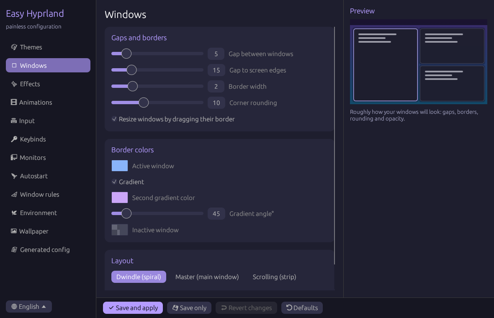

**English** · [Русский](README.ru.md) · [Deutsch](README.de.md)

# Easy Hyprland

An easy, good-looking GUI for configuring [Hyprland](https://hyprland.org).
You don't need to learn the config syntax: move the sliders, pick colors and press **Save and apply**.

Written in **Rust** with [egui](https://github.com/emilk/egui). The interface is available in English, Russian and German.



## Features

- 🎨 **Themes**: Catppuccin, Nord, Gruvbox, Neon and Minimal, one click each
- 🪟 **Windows**: gaps, borders, gradient borders, rounding, layout (dwindle, master, scrolling, monocle)
- ✨ **Effects**: opacity, blur, shadows, dimming of inactive windows
- 🎞 **Animations**: on/off, speed, style (smooth, snappy, bouncy)
- ⌨ **Input**: keyboard layouts and layout switching, mouse sensitivity, touchpad, three-finger workspace swipe
- 🔑 **Keybinds**: default programs and a shortcut editor
- 🖥 **Monitors**: resolution, refresh rate, position, scale
- 🚀 **Autostart** programs
- 📐 **Window rules**
- 🌿 **Environment variables**
- 🖼 **Wallpaper** with hyprpaper
- 📄 **Generated config**: view, copy, add your own lines
- 👀 **Live preview** of your windows inside the app
- 🛟 **Safe**: a backup is made before your config is touched, and Hyprland's config errors are shown after applying

## Supported Hyprland versions

| Hyprland | Config format | Support |
|---|---|---|
| **0.55 and newer** | Lua (`hyprland.lua`) | ✅ |
| **0.53 – 0.54** | hyprlang (`hyprland.conf`) | ✅ |
| older than 0.53 | old hyprlang syntax | ❌ |

The format is detected automatically: since 0.55, Hyprland loads `hyprland.lua` and only falls back to the old `hyprland.conf` when there is no Lua file, so the app writes to whichever one your Hyprland actually loads. You can also choose the format by hand on the **Themes** page.

## Installation

### 1. Install Rust

```bash
# Arch Linux
sudo pacman -S rust
# any distribution
curl --proto '=https' --tlsv1.2 -sSf https://sh.rustup.rs | sh
```

### 2. Build and install

```bash
git clone https://github.com/NeXtagG/easy-hyprland.git
cd easy-hyprland
cargo install --path .
```

The binary is installed to `~/.cargo/bin/easy-hyprland`. Make sure `~/.cargo/bin` is in your `PATH`.

To build without installing:

```bash
cargo build --release
./target/release/easy-hyprland
```

### 3. (Optional) Add it to your app launcher

```bash
mkdir -p ~/.local/share/applications
cat > ~/.local/share/applications/easy-hyprland.desktop <<EOF
[Desktop Entry]
Name=Easy Hyprland
Comment=Configure Hyprland
Exec=$HOME/.cargo/bin/easy-hyprland
Icon=preferences-desktop
Type=Application
Categories=Settings;
EOF
```

## Usage

1. Start `easy-hyprland` from a terminal or from your launcher (wofi, rofi, hyprlauncher…).
2. Pick a section on the left, for example **Themes** or **Windows**.
3. Change the settings. The preview on the right updates immediately.
4. Press **Save and apply** (or **Ctrl+S**). Hyprland reloads right away, no re-login needed.

The language is picked from your system locale. You can change it at the bottom of the sidebar.

| Button | What it does |
|---|---|
| ✔ Save and apply | writes the config, runs `hyprctl reload` and shows any config errors |
| 💾 Save only | only writes the files |
| ↩ Revert changes | goes back to the last saved settings |
| ⟲ Defaults | resets everything to the default values |

If you close the window with unsaved changes, the app asks whether to save them.

## How it works

- Your settings are written to a separate file:
  - Lua: `~/.config/hypr/easy-hyprland.lua`
  - hyprlang: `~/.config/hypr/easy-hyprland.conf`
- One line is appended to the end of your main config (`hyprland.lua` or `hyprland.conf`):
  ```lua
  require("easy-hyprland")                         -- Lua
  ```
  ```ini
  source = /home/you/.config/hypr/easy-hyprland.conf   # hyprlang
  ```
  Before that, a copy named `hyprland.lua.bak-<time>` (or `hyprland.conf.bak-<time>`) is created. Your existing config stays in place, and the app's settings are applied on top of it.
- If there is no main config yet, it is created.
- The app's own state lives in `~/.config/easy-hyprland/settings.json`.
- With the wallpaper enabled, `~/.config/hypr/hyprpaper.conf` is written. A foreign hyprpaper config is backed up first.
- `$XDG_CONFIG_HOME` is respected.

### Uninstall

Remove the `require("easy-hyprland")` or `source = …easy-hyprland.conf` line from your main config, then:

```bash
cargo uninstall easy-hyprland
rm -r ~/.config/easy-hyprland ~/.config/hypr/easy-hyprland.*
```

## Development

```bash
cargo run              # start the app
cargo test             # unit tests
tests/validate.sh      # check generated configs against Hyprland 0.56.2 (needs lua5.4 and python3)
```

`tests/validate.sh` generates sample configs in both formats and checks every option, dispatcher and window rule effect against lists taken from the Hyprland 0.56.2 sources (`tests/hyprland-0.56.2/`). The Lua configs are executed against a strict mock of the `hl` API.

Pull requests are welcome!

## License

This project is licensed under the **GNU GPL v3.0 or later**. The full text is in [LICENSE](LICENSE).

In plain words:
- ✅ anyone can **use** the program for free, including at work;
- ✅ you may **change** the code and **share** it;
- ❗ if you share a modified version, its source code must also be **open** under the same GPL-3.0 license.
