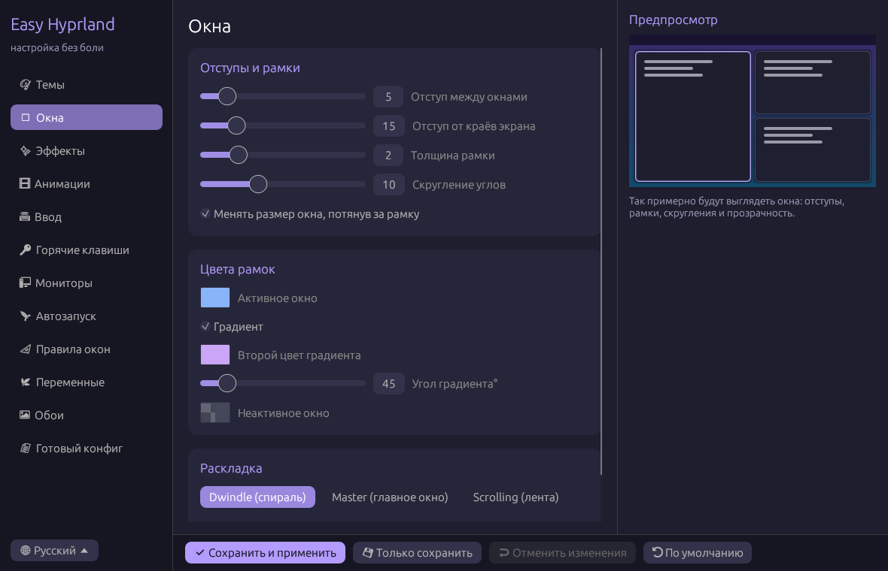

[English](README.md) · **Русский** · [Deutsch](README.de.md)

# Easy Hyprland

Программа для простой настройки [Hyprland](https://hyprland.org) с понятным графическим интерфейсом.
Не нужно разбираться в синтаксисе конфигов: двигай ползунки, выбирай цвета и нажимай **«Сохранить и применить»**.

Написано на **Rust** с [egui](https://github.com/emilk/egui). Интерфейс есть на русском, английском и немецком.



## Возможности

- 🎨 **Темы**: Catppuccin, Nord, Gruvbox, Неон, Минимализм, каждая в один клик
- 🪟 **Окна**: отступы, рамки, градиент рамки, скругление, раскладка (dwindle, master, scrolling, monocle)
- ✨ **Эффекты**: прозрачность, размытие (blur), тени, затемнение неактивных окон
- 🎞 **Анимации**: включение, скорость, стиль (плавный, быстрый, пружинистый)
- ⌨ **Ввод**: раскладки и их переключение, чувствительность мыши, тачпад, свайп тремя пальцами между рабочими столами
- 🔑 **Горячие клавиши**: программы по умолчанию и редактор сочетаний
- 🖥 **Мониторы**: разрешение, частота, позиция, масштаб
- 🚀 **Автозапуск** программ
- 📐 **Правила окон**
- 🌿 **Переменные окружения**
- 🖼 **Обои** через hyprpaper
- 📄 **Готовый конфиг**: просмотр, копирование и свои строки
- 👀 **Живой предпросмотр** окон прямо в программе
- 🛟 **Безопасно**: перед изменением конфига делается резервная копия, а после применения показываются ошибки конфига от Hyprland

## Поддерживаемые версии Hyprland

| Hyprland | Формат конфига | Поддержка |
|---|---|---|
| **0.55 и новее** | Lua (`hyprland.lua`) | ✅ |
| **0.53 – 0.54** | hyprlang (`hyprland.conf`) | ✅ |
| старше 0.53 | старый синтаксис hyprlang | ❌ |

Формат определяется автоматически. С версии 0.55 Hyprland загружает `hyprland.lua`, а старый `hyprland.conf` читает только если Lua-файла нет. Поэтому программа пишет в тот файл, который твой Hyprland реально загружает. Формат можно выбрать и вручную на странице **«Темы»**.

## Установка

### 1. Установи Rust

```bash
# Arch Linux
sudo pacman -S rust
# любой дистрибутив
curl --proto '=https' --tlsv1.2 -sSf https://sh.rustup.rs | sh
```

### 2. Собери и установи

```bash
git clone https://github.com/NeXtagG/easy-hyprland.git
cd easy-hyprland
cargo install --path .
```

Программа установится в `~/.cargo/bin/easy-hyprland`. Проверь, что `~/.cargo/bin` есть в `PATH`.

Собрать без установки:

```bash
cargo build --release
./target/release/easy-hyprland
```

### 3. (Необязательно) Добавь в меню приложений

```bash
mkdir -p ~/.local/share/applications
cat > ~/.local/share/applications/easy-hyprland.desktop <<EOF
[Desktop Entry]
Name=Easy Hyprland
Comment=Настройка Hyprland
Exec=$HOME/.cargo/bin/easy-hyprland
Icon=preferences-desktop
Type=Application
Categories=Settings;
EOF
```

## Использование

1. Запусти `easy-hyprland` из терминала или из меню (wofi, rofi, hyprlauncher…).
2. Слева выбери раздел, например **«Темы»** или **«Окна»**.
3. Меняй настройки. Предпросмотр справа обновляется сразу.
4. Нажми **«Сохранить и применить»** (или **Ctrl+S**). Hyprland обновится сразу, без перезахода.

Язык выбирается по языку системы. Поменять его можно внизу боковой панели.

| Кнопка | Что делает |
|---|---|
| ✔ Сохранить и применить | записывает конфиг, выполняет `hyprctl reload` и показывает ошибки конфига, если они есть |
| 💾 Только сохранить | только записывает файлы |
| ↩ Отменить изменения | возвращает последние сохранённые настройки |
| ⟲ По умолчанию | сбрасывает всё к стандартным значениям |

Если закрыть окно с несохранёнными изменениями, программа спросит, сохранить ли их.

## Как это работает

- Настройки записываются в отдельный файл:
  - Lua: `~/.config/hypr/easy-hyprland.lua`
  - hyprlang: `~/.config/hypr/easy-hyprland.conf`
- В конец основного конфига (`hyprland.lua` или `hyprland.conf`) добавляется одна строка:
  ```lua
  require("easy-hyprland")                         -- Lua
  ```
  ```ini
  source = /home/ты/.config/hypr/easy-hyprland.conf   # hyprlang
  ```
  Перед этим создаётся копия `hyprland.lua.bak-<время>` (или `hyprland.conf.bak-<время>`). Твой старый конфиг остаётся на месте, а настройки из программы применяются поверх него.
- Если основного конфига нет, он будет создан.
- Состояние программы хранится в `~/.config/easy-hyprland/settings.json`.
- Если включены обои, записывается `~/.config/hypr/hyprpaper.conf`. Чужой конфиг hyprpaper сначала сохраняется в копию.
- Учитывается `$XDG_CONFIG_HOME`.

### Как удалить

Удали строку `require("easy-hyprland")` или `source = …easy-hyprland.conf` из основного конфига и выполни:

```bash
cargo uninstall easy-hyprland
rm -r ~/.config/easy-hyprland ~/.config/hypr/easy-hyprland.*
```

## Разработка

```bash
cargo run              # запуск
cargo test             # юнит-тесты
tests/validate.sh      # проверка конфигов по Hyprland 0.56.2 (нужны lua5.4 и python3)
```

`tests/validate.sh` генерирует примеры конфигов в обоих форматах и сверяет каждую опцию, команду и эффект правил окон со списками из исходников Hyprland 0.56.2 (`tests/hyprland-0.56.2/`). Lua-конфиги выполняются на строгой заглушке API `hl`.

Pull request'ы приветствуются!

## Лицензия

Проект распространяется под лицензией **GNU GPL v3.0 или новее**, полный текст в файле [LICENSE](LICENSE).

Простыми словами:
- ✅ любой может **бесплатно использовать** программу, в том числе для работы;
- ✅ можно **изменять** код и **распространять** его;
- ❗ если ты распространяешь изменённую версию, её код тоже должен быть **открытым** под той же лицензией GPL-3.0.
